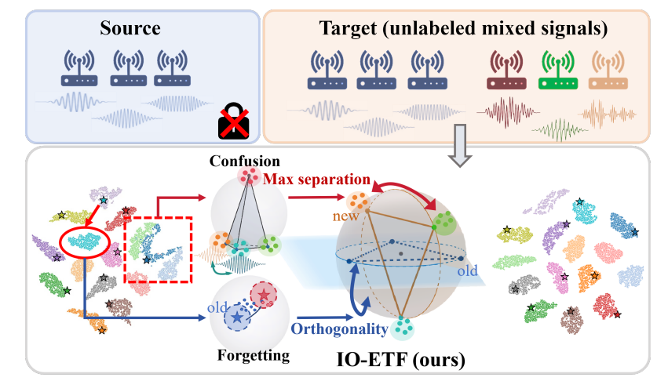
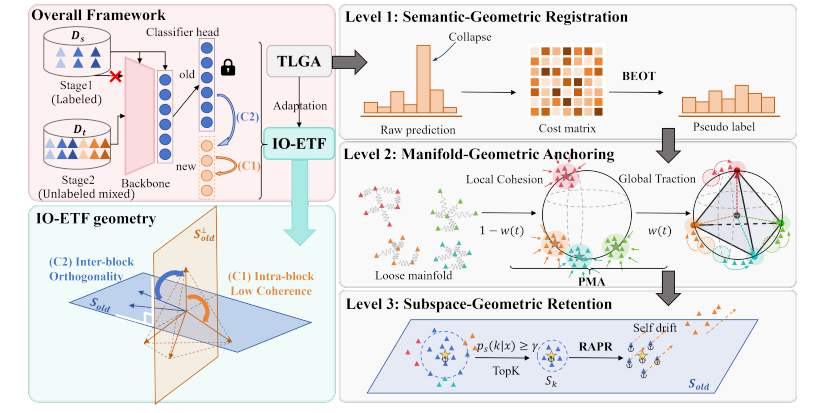
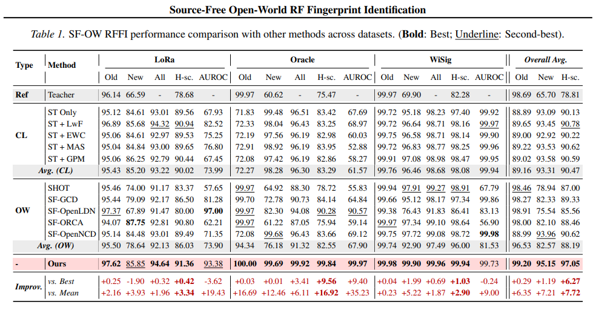
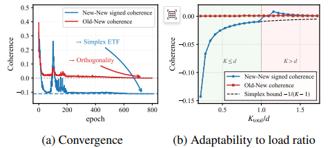
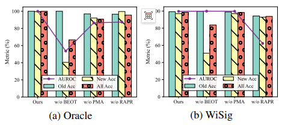

# Recognizing Unfamiliar Devices Without Original Data? The New Paradigm of Radio Frequency Fingerprinting with "Passive Open World"[with Python Code]

Recognizing unfamiliar devices without access to raw data? A new paradigm of "Source-Free Open-World RF Fingerprint Identification". This article delves into the understanding of how to achieve precise recognition of unknown radio frequency devices without access to original training data.
Just like everyone has a unique handwriting, every wireless device also leaves an unforgeable "hardware signature" in the transmitted signal due to the subtle differences of DAC, power amplifier, oscillator and other analog components.
The three major challenges in the real world. However, when moving from the lab to a real deployment of RF fingerprinting, there are three severe challenges:
Challenge One: Open-World
During training, only a subset of device categories can be covered; after deployment, the incoming new devices are labeled as "unknown category," and the system must identify these new devices without retraining.
Challenge 2: Source-Free
Due to privacy regulations and storage costs, deployment environments often cannot access the original training data. You can no longer review historical data to assist the model in adaptation.
Challenge 3: Unlabeled Streams
During the online deployment phase, the data stream of the new device is unlabeled, and the signals from both old and new devices are mixed together, requiring the model to independently differentiate.
The three predicaments combined to form a highly challenging issue - the Radio Frequency Fingerprinting (RFFI) of an open world without power source.
02 Core idea: Two-stage framework. In response to the above challenges, this paper proposes a sophisticated two-stage framework.
┌───────────────────────────────────────────────┐│ Stage 1: Source Domain Pre-training |│ ┌──────────┐   ┌───────────┐       ││ │ Known Devices │ ───► │ ResNet-18 │ ───► Pre-trained Model ││ │ Labeled Data │   │ + ETF Heads │        ││ └──────────┘   └───────────┘       │└─────────────────────────────────────────────────┘|                                                                                        |
Stage 2: Passive Open World Compatibility
This is the core innovation of this article. Upon receiving a mixed unlabeled data stream, the system accomplishes precise recognition of both new and existing devices through two major modules:
IO-ETF (Incremental Orthogonal ETF Classifier): Dynamically expands the classification space for new device categories
TLGA (Triple Geometry Alignment Strategy): Aligns semantics, manifolds, and subspaces under unlabeled conditions
03 Key Technologies in-depth analysis
3.1 IO-ETF: Incremental Orthogonal Tight Frame Classifier
Traditional classifiers require complete retraining when encountering new categories, whereas the IO-ETF classifier can be incrementally expanded, presenting a mathematically elegant design.
What is an ETF? An ETF (Equiangular Tight Frame) is a special vector set with two key properties:
1  
Equiangularity: The angle between any two ETF vectors is completely equal, meaning that the non-diagonal elements of M^T M are identical
2  
Tightness: ETF vectors uniformly distribute in space, forming a "tight" coordinate system
The mathematical construction formula for ETF is:
where (K) represents the number of categories. This formula ensures maximum separation between the prototype vectors of different categories.
The optimization process for incremental expansion When a new device appears, the IO-ETF does not need to retrain the entire classifier; instead, it generates ETF vectors for the new category through an optimization process:
1  
Randomly initialize the ETF vectors of the new category
2  
Iterate optimize using the Adam optimizer to minimize two loss terms:
New Separation Loss: Maximizes the angle between the new vector and the existing old vectors to avoid confusion between new and old categories
New Category Intra-Separation Loss: Maximizes the mutual angle between new categories to ensure sufficient separation of new categories
3  
Normalize the optimized vectors and concatenate them into the original ETF matrix
# Core Optimization Logic (Simplified Version)
First Layer: Semantic-Oriented Alignment (Semantic OT) - A global perspective utilizes the Sinkhorn-Knopp algorithm to balance the weakly augmented predictions from the model output, generating high-quality pseudo labels.
Sinkhorn-Knopp is an Optimal Transport algorithm that finds the optimal matching between model predictions and uniformly distributed classes. Intuitive, it's like doing a "quota distribution problem".
"Given that the sample sizes in each category are roughly equal, how can we fairly distribute a batch of unlabeled samples to each category?" The algorithm iteratively performs bidirectional normalization between rows (samples) and columns (classes), ultimately converging to an optimal allocation scheme that satisfies the dual random constraint.
This global balanced pseudo-labeling strategy effectively avoids the phenomenon of model "collapse" on minority classes.
Second Layer: Manifold Anchoring (Manifold Anchoring) — Local Viewpoint If the semantics-OT provides global constraints, then KNN contrastive learning is responsible for maintaining the local geometric structure of data.
Specific implementation:
1  
Maintain a feature memory bank (Feature Bank) to store the contrast features of all samples.
2  
Search for K nearest neighbors in the memory library for each sample.
3  
Use Supervised Contrastive Loss (SupCon Loss), to close the distance between each sample and its neighbors, and push away from other samples.
This "point-to-point" alignment method ensures that the features of similar devices are also close in the embedded space, preserving the manifold structure of data.
Third Layer: Subspace Retention - Memory Perspective to Address Disaster-like Forgetting - Models "forget" old categories when learning new ones - This paper introduces a frozen old model as a memory anchor:
1  
At the beginning of Stage II, create a copy of the trained model and freeze its parameters (old_model).
2  
For each input sample, perform forward propagation with both the current model and the old model simultaneously.
3  
Filter out samples with high confidence in the old model, labeled as "known class".
4  
Apply knowledge retention loss (Retention Loss) to the current model using these samples, forcing the model to "remember" old knowledge.
# Subspace Preservation Logic with torch.no_grad():
Dynamic weight scheduling triple alignment is not a simple summation. This paper designs a dynamic weight scheduling mechanism:
w_t = linear_rampup(epoch, warmup, total_epochs) # From 0 linearly increasing to 1 loss_align = w_t * loss_global + (1 - w_t) * loss_local
loss_total = loss_align + 20.0 * loss_ret
Training early (w_t small): Prioritize local alignment (KNN contrastive learning), helping the model establish basic understanding of data manifold
Training late (w_t large): Prioritize global alignment (semantic OTL), guiding the model to make more balanced category discrimination
Throughout the training process: The knowledge preservation loss always participates in training with a larger weight (20.0 times), preventing forgetting
4 Experimental settings and results dataset This paper has been validated on three real-world radio frequency datasets:
Dataset  
Signal type  
Collected equipment  
Typical number of categories  
WiSigWiFi signal  
USRP + ORBIT platform  
10 classes  
Oracle cellular signal  
USRP X310 transmitter  
16 classes  
LoRaLoRa signal  
Commercial LoRa device  
30 classes  
The three datasets cover different wireless protocols and actual deployment scenarios, ensuring the comprehensiveness of the experiment.
Evaluation metrics are calculated using the Hungarian matching algorithm (Hungarian algorithm) for alignment prediction labels with true labels, calculating:
Known class accuracy (Known Acc)  
Novel class accuracy (Novel Acc)  
Overall accuracy (All Acc)  
H-score (a comprehensive metric for balancing known and novel classes)  
AUROC (ability to distinguish between known/unknown classes)
The key results of the experiment were conducted under a setting where approximately 34% to 50% of the new categories were introduced. The findings indicate:
- The geometric prior provided by IO-ETF effectively pushes new categories into the blank spaces in the feature space, reducing interference between old and new categories.
- The TLGA triple alignment strategy maintains the discriminative power against known categories while accurately identifying new ones.
- Compared with existing incremental learning and open world recognition methods, the SFOW framework achieved optimal results across three datasets.
- Conclusion and Future Outlook: The proposed SFOW-RFFI framework addresses the core challenges of radio frequency fingerprinting in real deployments through an elegant geometric perspective.
- IO-ETF provides a scalable geometric structure prior that enables models to "accommodate new knowledge".
- TLGA guides unlabeled data alignment from three levels: semantics, manifolds, and subspaces, enabling models to neither forget old knowledge nor accept new information.
- The two-stage design ensures the framework's flexible deployment: once pretrained, adaptable multiple times.
Future directions include exploring more wireless protocols (such as 5G NR), introducing self-supervised pretraining to reduce dependence on labels, and verifying robustness in more real deployment scenarios.

## Images

<!-- PAYMENT_BLOCK -->

## Get this dataset

- Payment link (Stripe): [Buy now](https://buy.stripe.com/3cs8yP7sY87d0vu9AB)
- Payment QR code: 

<!-- /PAYMENT_BLOCK -->
